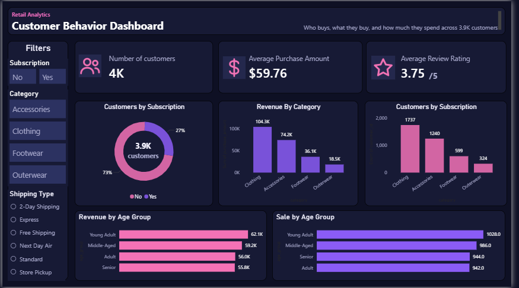

# Retail Customer Behavior & Revenue Analytics

End-to-end retail analytics project using **Python, PostgreSQL and Power BI** to find out which customers, products and segments drive revenue.

## Business Problem

A retail company wants to understand its customers' shopping behavior. This project answers questions such as:

- Which product categories and items generate the most revenue?
- Do subscribers, discount users or particular age groups spend more?
- Which products are rated highest by customers?
- How loyal are customers, and are repeat buyers more likely to subscribe?

## Tools Used

| Tool | Purpose |
| --- | --- |
| Python (Pandas) | Data loading, cleaning and exploratory analysis |
| PostgreSQL | Business analysis with SQL |
| Power BI | Interactive dashboard |
| Excel | Initial dataset review |
| GitHub | Version control and portfolio |

## Dataset

- **File:** `data/customer_shopping_behavior.csv`
- **Size:** 3,900 customer purchases, 18 columns
- **Fields:** Customer ID, Age, Gender, Item Purchased, Category, Purchase Amount (USD), Location, Size, Color, Season, Review Rating, Subscription Status, Shipping Type, Discount Applied, Promo Code Used, Previous Purchases, Payment Method, Frequency of Purchases
- 
## Project Structure

```
customer-shopping-trends-analysis/
├── README.md
├── data/
│   └── customer_shopping_behavior.csv
├── notebooks/
│   └── customer_shopping_behaviour_analysis.ipynb
├── sql/
│   └── business_analysis_queries.sql
├── dashboard/
│   ├── retail_shopping_dashboard.pbix
│   └── dashboard_preview.png

```

## Project Workflow

1. **Data cleaning and EDA (Python):** checked data quality, handled missing values, created age groups and prepared the data for analysis.
2. **Business analysis (SQL):** loaded the cleaned data into PostgreSQL and answered 10 business questions.
3. **Dashboard (Power BI):** built an interactive dashboard with KPIs, charts and filters.
4. **Documentation:** summarized the findings in a project report.

## Data Quality Findings

- 37 missing Review Ratings (0.95% of rows); no duplicate rows or customer IDs.
- `Discount Applied` and `Promo Code Used` hold identical values in all 3,900 rows, so one of them is redundant.
- Purchase amounts range from $20 to $100 (average $59.76); customers are aged 18 to 70.

## SQL Analysis

The file [`sql/business_analysis_queries.sql`](sql/business_analysis_queries.sql) answers 10 business questions using aggregations, subqueries, CTEs, CASE statements and window functions:

1. Total revenue by gender
2. Customers who used a discount but still spent above the average purchase
3. Top 5 products by average review rating
4. Average purchase amount: Standard vs Express shipping
5. Do subscribers spend more? (average spend and total revenue)
6. Top 5 products by share of purchases with a discount
7. Customer segmentation into New, Returning and Loyal (CTE + CASE)
8. Top 3 most purchased products within each category (ROW_NUMBER window function)
9. Are repeat buyers (more than 5 previous purchases) likely to subscribe?
10. Revenue contribution of each age group

## Power BI Dashboard

The dashboard (`dashboard/retail_shopping_dashboard.pbix`) is a one-page "Retail Analytics: Customer Behavior Dashboard" with:

- **KPI cards:** number of customers, average purchase amount, average review rating
- **Charts:** revenue by category, customers by subscription status, revenue by age group
- **Filters (slicers):** subscription status, category, shipping type



## Key Insights

- **Clothing and accessories drive three-quarters of revenue:** together $178,464 of $233,081 (76.6%).
- **Revenue follows customer volume, not basket size:** the average purchase stays between $58 and $62 across genders, age groups and seasons.
- **Subscribers do not spend more:** the 27% of customers who subscribe average $59.49 per purchase vs $59.87 for non-subscribers.
- **Discounts do not raise basket size:** 43% of purchases used a discount, averaging $59.28 vs $60.13 without one.
- **Fall is the strongest season:** $60,018 in revenue, 7.6% above summer ($55,777).

## Recommendations

- Keep clothing and accessories well stocked, since they bring in most of the revenue.
- Test subscription and discount offers that raise basket size, such as bundles or free-shipping thresholds.
- Plan inventory and campaigns around the fall peak, especially outerwear.

## Contact

**Siddhi Shinde** | [LinkedIn](https://linkedin.com/in/siddhi-shinde18) | shindesiddhi1806@gmail.com
